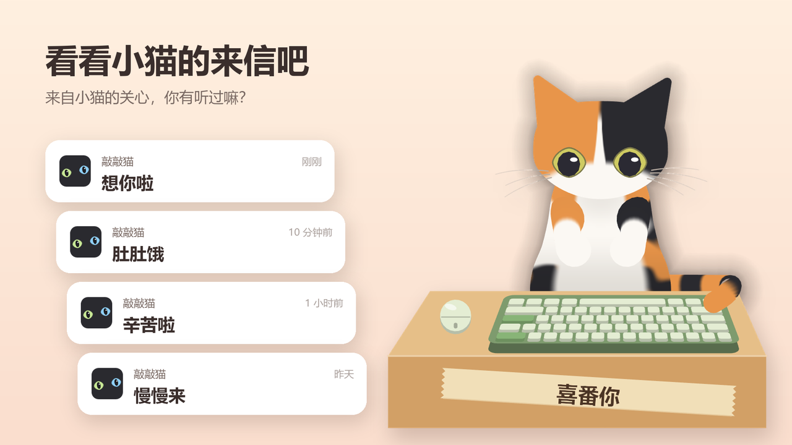

  

<h1 align="center">TYPINCAT · 敲敲猫</h1>

  活灵活现的桌面小猫 · A desktop cat that feels alive 
  ポチポチねこ · 톡톡냥

  <a href="https://github.com/alienbai1107-art/TYPINCAT/releases/latest"><b>⬇ 下载绿色版 Download (portable)</b></a>
  &nbsp;·&nbsp;
  <a href="https://apps.microsoft.com/detail/9PG0GM6TGV7S">Microsoft Store</a>
  &nbsp;·&nbsp;
  <a href="https://ah-studio.pages.dev/typincat/">隐私政策 Privacy</a>

## 中文

一只陪你打字的桌面小猫。你敲键盘，它就用小爪子跟着敲同一个键；你动鼠标，它就去扒拉鼠标。打字太快它会着急甩尾巴，一直不理它就会犯困睡着。摸摸它的头，它会开心到开花。偶尔，它还会在胶带上给你留一句话。

- **捏一只你自己的猫**：脸型、身材、尾巴、毛色、异瞳、花纹，还能直接在猫身上画画
- **一肚子小心思**：偷瞄、坏笑、摸鱼、受惊炸毛
- **小猫的来信**：偶尔自己打几句笨笨的话（中 / 日 / 英 / 韩）
- **接入 Claude Code**：AI 干活时它敲键盘，需要你确认时歪头冒问号
- **隐私优先**：按键只在本机用来做动画，不保存、不联网

### 下载和使用（绿色版）

1. 到 [Releases](https://github.com/alienbai1107-art/TYPINCAT/releases/latest) 下载 `TYPINCAT_敲敲猫_绿色版_1.0.0.zip`。
2. 解压整个文件夹，双击 `TypingWithLove.exe`。不用安装，也不需要授权码。
3. 右键小猫：调整小猫 / 隐藏小猫 / 退出。

第一次打开时如果出现「Windows 已保护你的电脑」，点「更多信息」→「仍要运行」（绿色版没有代码签名）。想要自动更新，可以从 [Microsoft Store](https://apps.microsoft.com/detail/9PG0GM6TGV7S) 安装。

系统要求：Windows 10 1809 或更高，64 位。

## English

A little desktop cat that types along with you. Type, and it taps the same keys with its paws; move the mouse, and it bats at it. Type too fast and it lashes its tail; leave it alone and it dozes off. Pet its head and it blooms with joy. Now and then it even leaves you a little note on its tape.

- **Make your own cat**: face, build, tail, coat, odd eyes, patterns, and paint right on the cat
- **Full of little moods**: side-eyes, smug grins, slacking off, puffing up when startled
- **Notes from your cat**: it types silly little messages by itself (English / Chinese / Japanese / Korean)
- **Works with Claude Code**: it types while the AI works and tilts its head with a "?" when it needs you
- **Privacy first**: keystrokes are used on your PC only to animate the cat. Nothing is stored, and the app never goes online.

### Download (portable)

1. Get `TYPINCAT_敲敲猫_绿色版_1.0.0.zip` from [Releases](https://github.com/alienbai1107-art/TYPINCAT/releases/latest).
2. Unzip the whole folder and run `TypingWithLove.exe`. No install, no license key.
3. Right-click the cat for Edit cat / Hide cat / Quit.

If Windows SmartScreen appears on first launch, click "More info" → "Run anyway" (the portable build is not code-signed). For automatic updates, get it from the [Microsoft Store](https://apps.microsoft.com/detail/9PG0GM6TGV7S).

Requires Windows 10 1809 or later, 64-bit.

---

© 2026 Orbit Group. All rights reserved. Free to download and use; please do not redistribute modified copies. Third-party credits: [THIRD_PARTY_NOTICES.md](THIRD_PARTY_NOTICES.md).
