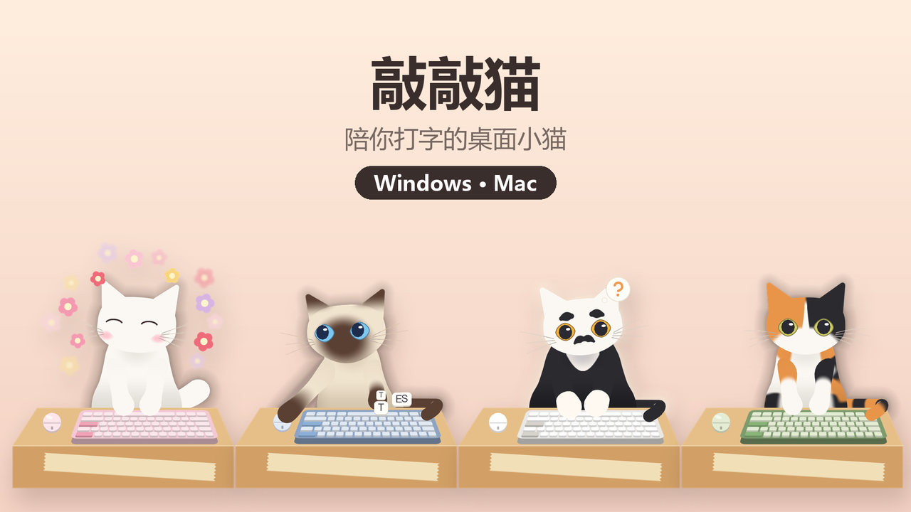
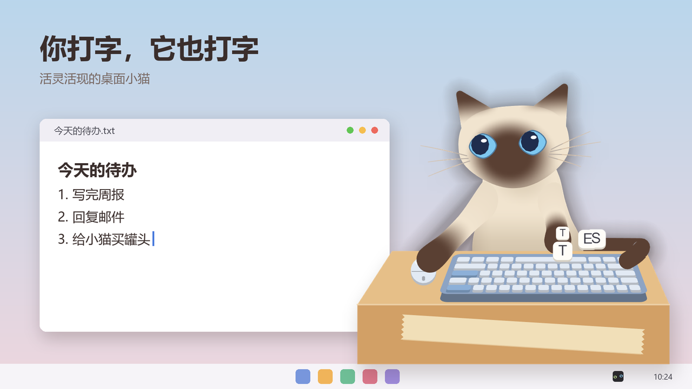
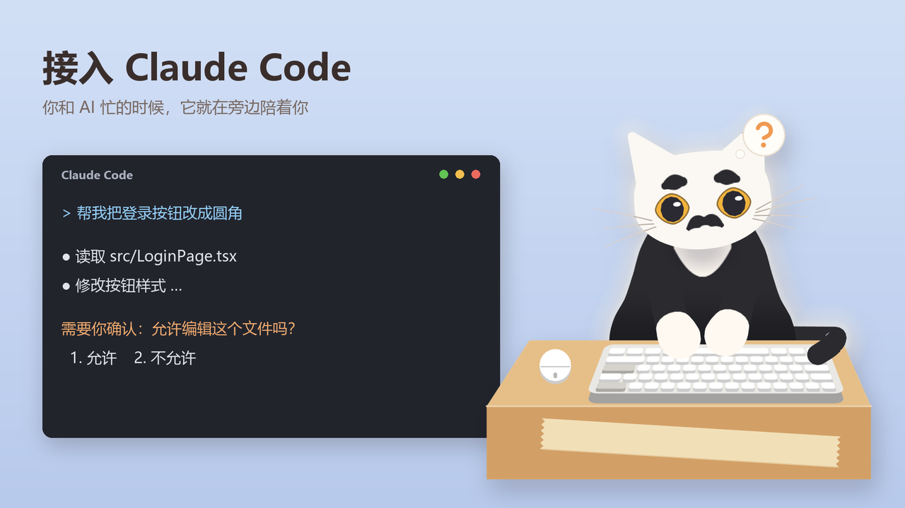
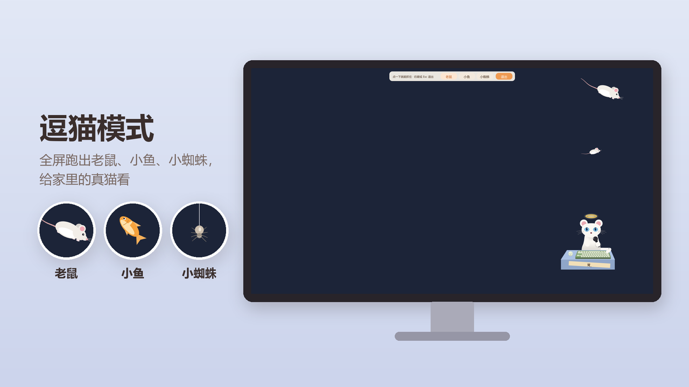
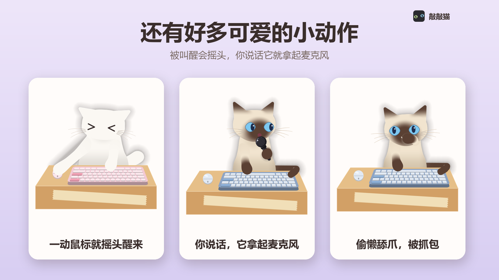

<p align="center">
  
</p>

<h1 align="center">TYPINCAT · 敲敲猫</h1>

<p align="center">
  活灵活现的桌面小猫 · A desktop cat that feels alive<br>
  ポチポチねこ · 톡톡냥
</p>

<p align="center">
  <a href="https://github.com/alienbai1107-art/TYPINCAT/releases/latest"><b>⬇ 下载绿色版 Download (portable)</b></a>
  &nbsp;·&nbsp;
  <a href="https://github.com/alienbai1107-art/TYPINCAT/releases/tag/v1.2.0-beta.1"><b>Mac（测试版 beta）</b></a>
  &nbsp;·&nbsp;
  <a href="https://apps.microsoft.com/detail/9PG0GM6TGV7S">Microsoft Store</a>
  &nbsp;·&nbsp;
  <a href="https://ah-studio.pages.dev/typincat/">隐私政策 Privacy</a>
</p>



## 中文

一只陪你打字的桌面小猫。你敲键盘，它就用小爪子跟着敲同一个键；你动鼠标，它就去扒拉鼠标。打字太快它会着急甩尾巴，一直不理它就会犯困睡着。摸摸它的头，它会开心到开花。偶尔，它还会在胶带上给你留一句话。

- **捏一只你自己的猫**：脸型、身材、尾巴、毛色、异瞳、花纹，还能直接在猫身上画画（支持数位板笔压、喷枪、吸色）
- **绘画板模式**：画画的人可以把桌上的键盘换成绘画板，小猫握着笔陪你画
- **也可以是小狗、小鼠**：5 种狗耳朵、鼻子长短、4 种尾巴和小狗花纹；圆耳朵的小鼠
- **创意工坊**：看看大家捏的猫狗，点一下就能试穿；把自己的作品分享出去，每件都有一个编号，发给朋友一搜就到
- **打扮它**：翅膀、光环、蝴蝶结、帽子、圣诞帽、生日帽、铃铛项圈、眼镜、工牌、领巾；键盘、纸箱、胶带的颜色也能自己调
- **直播模式**：一键绿幕，OBS 抠出小猫放进直播间
- **逗猫模式**：全屏跑出老鼠、小鱼、小蜘蛛，给家里的真猫看
- **换电脑也带着它**：一键导出成一个文件，在别的电脑上导入
- **一肚子小心思**：偷瞄、坏笑、摸鱼、受惊炸毛
- **小猫的来信**：偶尔自己打几句笨笨的话（中 / 日 / 英 / 韩）
- **接入 Claude Code**：AI 干活时它敲键盘，需要你确认时歪头冒问号
- **隐私优先**：按键只在本机用来做动画，不保存、不上传；只有打开创意工坊时才联网









### 下载和使用（Windows 绿色版）

1. 到 [Releases](https://github.com/alienbai1107-art/TYPINCAT/releases/latest) 下载 `TYPINCAT_portable_1.3.1.zip`。
2. 解压整个文件夹，双击 `TypingWithLove.exe`。不用安装，也不需要授权码。
3. 右键小猫：调整外观 / 逗猫模式 / 隐藏 / 退出。

第一次打开时如果出现「Windows 已保护你的电脑」，点「更多信息」→「仍要运行」（绿色版没有代码签名）。想要自动更新，可以从 [Microsoft Store](https://apps.microsoft.com/detail/9PG0GM6TGV7S) 安装。

系统要求：Windows 10 1809 或更高，64 位。

### 下载和使用（Mac 测试版）

> Mac 版是测试版：还没有在真机上充分测试过，遇到问题欢迎在 [Issues](https://github.com/alienbai1107-art/TYPINCAT/issues) 反馈。

1. 到 [Releases](https://github.com/alienbai1107-art/TYPINCAT/releases/tag/v1.2.0-beta.1) 下载 `TYPINCAT_mac_1.2.0-beta.zip`，解压后把 `TypingWithLove.app` 拖进「应用程序」文件夹。
2. 第一次打开：在 app 上**右键 →「打开」→ 再点「打开」**（Mac 版没有苹果签名，直接双击会被拦下）。
   如果提示「已损坏，无法打开」，打开「终端」执行下面这行，再右键打开：
   ```
   xattr -cr /Applications/TypingWithLove.app
   ```
3. 小猫要读键盘和鼠标才能跟着你动：到「系统设置 → 隐私与安全性 → 输入监控」里打开 TypingWithLove，然后退出小猫再重新打开。

系统要求：macOS 12 或更高。只有 Intel 版本，Apple 芯片的 Mac 会通过 Rosetta 运行（第一次如果提示安装 Rosetta，点「安装」即可）。

### 请作者喝杯奶茶

敲敲猫是免费的。如果它陪你度过了愉快的时光，可以用微信扫一扫，请作者喝杯奶茶 ☕ 谢谢支持！


## English

A little desktop cat that types along with you. Type, and it taps the same keys with its paws; move the mouse, and it bats at it. Type too fast and it lashes its tail; leave it alone and it dozes off. Pet its head and it blooms with joy. Now and then it even leaves you a little note on its tape.

- **Make your own cat**: face, build, tail, coat, odd eyes, patterns, and paint right on the cat (pen pressure, airbrush, eyedropper)
- **Drawing tablet desk**: swap the keyboard for a drawing tablet and the cat draws along with a pen
- **Or a puppy, or a mouse**: 5 kinds of dog ears, muzzle length, 4 tails and puppy coats; round mouse ears
- **Workshop**: browse cats and dogs other people made and try them on with one click; share your own, each with a number your friends can search for
- **Dress it up**: wings, a halo, a bow, hats (Santa and birthday too), a bell collar, glasses, a badge, a bandana; recolour the keyboard, box and tape
- **Streaming mode**: a green screen in one click, so OBS can key the cat into your stream
- **Mouse play**: mice, fish or little spiders run across the whole screen for your real cat to watch
- **Take it along**: export your cat to one file and import it on another computer
- **Full of little moods**: side-eyes, smug grins, slacking off, puffing up when startled
- **Notes from your cat**: it types silly little messages by itself (English / Chinese / Japanese / Korean)
- **Works with Claude Code**: it types while the AI works and tilts its head with a "?" when it needs you
- **Privacy first**: keystrokes are used on your PC only to animate the cat, never stored or sent. The app goes online only while the Workshop is open.

### Download (Windows, portable)

1. Get `TYPINCAT_portable_1.3.1.zip` from [Releases](https://github.com/alienbai1107-art/TYPINCAT/releases/latest).
2. Unzip the whole folder and run `TypingWithLove.exe`. No install, no license key.
3. Right-click the cat for Edit look / Mouse play / Hide / Quit.

If Windows SmartScreen appears on first launch, click "More info" → "Run anyway" (the portable build is not code-signed). For automatic updates, get it from the [Microsoft Store](https://apps.microsoft.com/detail/9PG0GM6TGV7S).

Requires Windows 10 1809 or later, 64-bit.

### Download (Mac, beta)

> The Mac version is a beta: it has not been fully tested on real Macs yet. Please report problems in [Issues](https://github.com/alienbai1107-art/TYPINCAT/issues).

1. Get `TYPINCAT_mac_1.2.0-beta.zip` from [Releases](https://github.com/alienbai1107-art/TYPINCAT/releases/tag/v1.2.0-beta.1), unzip it and drag `TypingWithLove.app` into Applications.
2. First launch: **right-click the app → Open → Open** (it is not signed by Apple, so a double-click is blocked).
   If macOS says the app "is damaged and can't be opened", run this in Terminal, then right-click → Open again:
   ```
   xattr -cr /Applications/TypingWithLove.app
   ```
3. The cat needs to see your keyboard and mouse: allow TypingWithLove in System Settings → Privacy & Security → Input Monitoring, then quit and reopen the cat.

Requires macOS 12 or later. Intel build only; Apple silicon Macs run it through Rosetta (install Rosetta if asked on first launch).

---

© 2026 Orbit Group. All rights reserved. Free to download and use; please do not redistribute modified copies. Third-party credits: [THIRD_PARTY_NOTICES.md](THIRD_PARTY_NOTICES.md).
